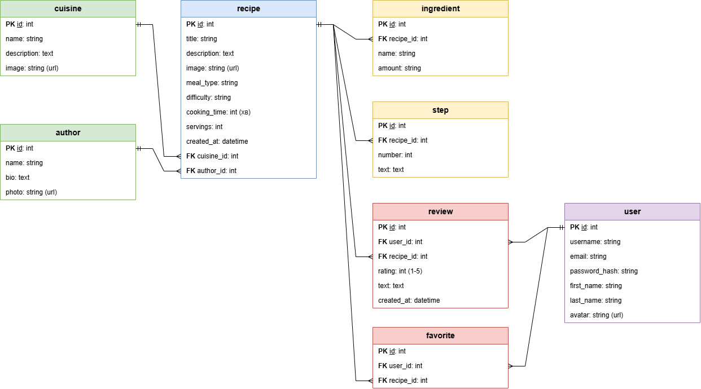

# Рецептник

Сайт з рецептами, де можна швидко знайти, що приготувати.

Фронтенд: [bogaevska-recipes-frontend](https://github.com/darynab-stack/bogaevska-recipes-frontend)

## Про проєкт

Тут зібрані рецепти з різних кухонь світу. Рецепт можна знайти за назвою або за продуктом, який є вдома. Список можна відфільтрувати за кухнею, типом страви, складністю і часом приготування, а ще відсортувати за назвою, часом приготування чи датою додавання.

На сторінці рецепта є фото, опис, інгредієнти з кількістю, кроки приготування, час і кількість порцій.

Що ще є на сайті:

- сторінки кухонь, де видно всі рецепти цієї кухні
- сторінки авторів з короткою інформацією про автора і всіма його рецептами
- реєстрація і вхід
- профіль, де можна змінити дані про себе і подивитись свої улюблені рецепти та відгуки
- улюблені, куди можна зберегти рецепт, щоб потім не шукати
- відгуки з оцінкою від 1 до 5
- сторінка «Про нас» з контактами

Рецепти, кухні й авторів можна додавати, редагувати і видаляти.

## Зміст

- [Як запустити проєкт](#як-запустити-проєкт)
- [Загальні правила](#загальні-правила)
- [Формат помилок](#формат-помилок)
- [Рецепти](#рецепти)
- [Кухні](#кухні)
- [Автори](#автори)
- [Відгуки](#відгуки)
- [Користувачі](#користувачі)
- [Схема бази даних](#схема-бази-даних)

## Як запустити проєкт

Потрібен Python 3.12.

1. Склонуйте репозиторій і перейдіть у папку проєкту:

   ```bash
   git clone https://github.com/darynab-stack/bogaevska-recipes.git
   cd bogaevska-recipes
   ```

2. Створіть і активуйте віртуальне оточення:

   ```bash
   py -3.12 -m venv .venv
   source .venv/Scripts/activate
   ```

   На Linux або macOS: `python3 -m venv .venv` і `source .venv/bin/activate`.

3. Встановіть залежності:

   ```bash
   python -m pip install -r requirements.txt
   ```

   Для перевірок оформлення коду (`check_submission.py`) також потрібен `requirements-dev.txt`.

4. Створіть базу даних:

   ```bash
   python manage.py migrate
   ```

5. Запустіть сервер:

   ```bash
   python manage.py runserver
   ```

   API буде доступне на `http://127.0.0.1:8000/api/`.

### Postman

Колекція з усіма запитами лежить у `postman/recipes.postman_collection.json`. Її можна імпортувати в Postman (Import) і запустити цілком (Run). Базова адреса задана у змінній `{{base_url}}`, за замовчуванням `http://127.0.0.1:8000/api`. Папки варто запускати по черзі, від 1 до 4: остання папка видаляє все, що створили попередні.

### Фронтенд

Фронтенд лежить в окремому репозиторії і запускається через Live Server на `http://127.0.0.1:5500`. Бекенд дозволяє запити з `http://127.0.0.1:5500` і `http://localhost:5500` (налаштування `CORS_ALLOWED_ORIGINS` у `config/settings.py`).

## Загальні правила

- Усі адреси починаються з `/api/` і закінчуються слешем, наприклад `/api/recipes/` і `/api/recipes/1/`.
- Дані передаються і повертаються у форматі JSON.
- Зв'язки з іншими об'єктами передаються як `id`, наприклад `"cuisine": 1`.
- Сторінка «Про нас» статична, тому окремого ендпоінта для неї немає.

Які статус-коди повертає сервер:

| Код | Значення |
|---|---|
| `200 OK` | все добре, у відповіді є дані |
| `201 Created` | щось нове створено |
| `204 No Content` | все добре, але у відповіді нічого немає (після видалення) |
| `400 Bad Request` | у запиті щось не так, наприклад не заповнене обов'язкове поле |
| `401 Unauthorized` | користувач не увійшов |
| `403 Forbidden` | у користувача немає прав на цю дію |
| `404 Not Found` | з таким id нічого немає |
| `409 Conflict` | дію не можна виконати через інші дані, наприклад видалити кухню, в якій є рецепти |

> **TODO:** як саме робити авторизацію (токен чи сесія). Розберусь, коли пройдемо цю тему.

> **TBD:** хто може додавати, редагувати і видаляти рецепти, кухні й авторів. Будь-хто чи тільки адмін? Поки що всі ендпоінти відкриті.

## Формат помилок

Усі помилки мають однаковий вигляд:

```json
{
  "detail": "Пояснення, що сталося і що зробити",
  "errors": {}
}
```

- `detail` є завжди.
- `errors` містить помилки по конкретних полях, якщо дані не пройшли перевірку. В інших випадках це порожній об'єкт.

Приклад для `400`, коли не вказана назва кухні:

```json
{
  "detail": "Дані не пройшли перевірку. Виправте поля з помилками.",
  "errors": {
    "name": ["This field is required."]
  }
}
```

Приклад для `409`, коли видаляють кухню з рецептами:

```json
{
  "detail": "Неможливо видалити кухню, бо в ній є рецепти (3). Спершу видаліть їх або перенесіть в іншу кухню.",
  "errors": {}
}
```

Приклад для `404`:

```json
{
  "detail": "Об'єкт з таким id не знайдено.",
  "errors": {}
}
```

## Рецепти

### Отримати список рецептів

Використовується на головній сторінці.

`GET /api/recipes/`

Параметри запиту (усі необов'язкові):

| Параметр | Опис | Приклад |
|---|---|---|
| `search` | пошук за назвою | `search=борщ` |
| `ingredient` | пошук за інгредієнтом | `ingredient=гарбуз` |
| `cuisine` | id кухні | `cuisine=1` |
| `meal_type` | тип страви: `breakfast`, `soup`, `main`, `salad`, `dessert`, `drink` | `meal_type=soup` |
| `difficulty` | складність: `easy`, `medium`, `hard` | `difficulty=easy` |
| `max_time` | максимальний час приготування в хвилинах | `max_time=30` |
| `sort` | сортування: `title` (за назвою), `time` (спочатку найшвидші), `newest` (спочатку нові) | `sort=time` |

Приклад: `GET /api/recipes/?search=борщ&cuisine=1&sort=time`

Відповідь: `200 OK`

```json
[
  {
    "id": 1,
    "title": "Український борщ",
    "image": "https://example.com/borshch.jpg",
    "cuisine": 1,
    "meal_type": "soup",
    "difficulty": "medium",
    "cooking_time": 90
  }
]
```

Помилки: `400`, якщо `cuisine` або `max_time` не число, або `sort` має невідоме значення.

> **TODO:** рейтинг рецепта (середня оцінка з відгуків) і сортування за рейтингом та популярністю. Зроблю разом з відгуками й улюбленими.

### Отримати один рецепт

Використовується на сторінці рецепта.

`GET /api/recipes/{id}/`

Відповідь: `200 OK`

```json
{
  "id": 1,
  "title": "Український борщ",
  "description": "Класичний борщ на яловичому бульйоні",
  "image": "https://example.com/borshch.jpg",
  "cuisine": 1,
  "author": 3,
  "meal_type": "soup",
  "difficulty": "medium",
  "cooking_time": 90,
  "servings": 6,
  "ingredients": [
    { "name": "Буряк", "amount": "2 шт" },
    { "name": "Капуста", "amount": "300 г" }
  ],
  "steps": [
    { "number": 1, "text": "Зварити бульйон" },
    { "number": 2, "text": "Натерти буряк і обсмажити з морквою" }
  ],
  "created_at": "2026-10-12T10:00:00Z"
}
```

Помилки: `404`, якщо рецепта не існує.

### Додати рецепт

`POST /api/recipes/`

Тіло запиту:

```json
{
  "title": "Український борщ",
  "description": "Класичний борщ на яловичому бульйоні",
  "image": "https://example.com/borshch.jpg",
  "cuisine": 1,
  "author": 3,
  "meal_type": "soup",
  "difficulty": "medium",
  "cooking_time": 90,
  "servings": 6,
  "ingredients": [
    { "name": "Буряк", "amount": "2 шт" }
  ],
  "steps": [
    { "number": 1, "text": "Зварити бульйон" }
  ]
}
```

`description` і `image` необов'язкові. `cooking_time` і `servings` мають бути не менше 1. У рецепті має бути хоча б один інгредієнт і хоча б один крок.

Відповідь: `201 Created`, у тілі створений рецепт (як у `GET /api/recipes/{id}/`).

Помилки: `400`, якщо не вистачає обов'язкових полів, значення не з дозволеного списку, немає інгредієнтів чи кроків, або кухні чи автора з таким id не існує.

### Інші ендпоінти рецептів

| Що робить | Запит | Тіло запиту | Відповідь | Помилки |
|---|---|---|---|---|
| Змінити рецепт | `PATCH /api/recipes/{id}/` | тільки поля, які треба змінити, наприклад `{"cooking_time": 80}`. Якщо передати `ingredients` або `steps`, старий список повністю заміниться новим | `200`, оновлений рецепт | `400`, `404` |
| Видалити рецепт | `DELETE /api/recipes/{id}/` | немає | `204`, без тіла. Інгредієнти й кроки видаляються разом з рецептом | `404` |

## Кухні

### Отримати список кухонь

Використовується на сторінці кухонь і у фільтрі на головній.

`GET /api/cuisines/`

Відповідь: `200 OK`

```json
[
  {
    "id": 1,
    "name": "Українська",
    "description": "Борщ, вареники, голубці та інші страви",
    "image": "https://example.com/ukrainian.jpg"
  }
]
```

### Отримати одну кухню

`GET /api/cuisines/{id}/`

Відповідь: `200 OK`

```json
{
  "id": 1,
  "name": "Українська",
  "description": "Борщ, вареники, голубці та інші страви",
  "image": "https://example.com/ukrainian.jpg"
}
```

Помилки: `404`.

### Додати кухню

`POST /api/cuisines/`

Тіло запиту:

```json
{
  "name": "Українська",
  "description": "Борщ, вареники, голубці та інші страви",
  "image": "https://example.com/ukrainian.jpg"
}
```

Обов'язкова лише назва.

Відповідь: `201 Created`, у тілі створена кухня.

Помилки: `400`, якщо немає назви або кухня з такою назвою вже є.

### Інші ендпоінти кухонь

| Що робить | Запит | Тіло запиту | Відповідь | Помилки |
|---|---|---|---|---|
| Рецепти кухні (на сторінці кухні) | `GET /api/cuisines/{id}/recipes/` | немає | `200`, список рецептів як у `GET /api/recipes/` | `404` |
| Змінити кухню | `PATCH /api/cuisines/{id}/` | тільки поля, які треба змінити | `200`, оновлена кухня | `400`, `404` |
| Видалити кухню | `DELETE /api/cuisines/{id}/` | немає | `204`, без тіла | `404`, `409`, якщо в кухні є рецепти |

Кухню, в якій є рецепти, видалити не можна. Спершу треба видалити ці рецепти або перенести їх в іншу кухню.

## Автори

### Отримати список авторів

`GET /api/authors/`

Відповідь: `200 OK`

```json
[
  {
    "id": 3,
    "name": "Олена Коваль",
    "bio": "Кулінарка, готує домашні українські страви",
    "photo": "https://example.com/olena.jpg"
  }
]
```

### Отримати одного автора

`GET /api/authors/{id}/`

Відповідь: `200 OK`

```json
{
  "id": 3,
  "name": "Олена Коваль",
  "bio": "Кулінарка, готує домашні українські страви",
  "photo": "https://example.com/olena.jpg"
}
```

Помилки: `404`.

### Додати автора

`POST /api/authors/`

Тіло запиту:

```json
{
  "name": "Олена Коваль",
  "bio": "Кулінарка, готує домашні українські страви",
  "photo": "https://example.com/olena.jpg"
}
```

Обов'язкове лише ім'я.

Відповідь: `201 Created`, у тілі створений автор.

Помилки: `400`, якщо немає імені.

### Інші ендпоінти авторів

| Що робить | Запит | Тіло запиту | Відповідь | Помилки |
|---|---|---|---|---|
| Рецепти автора (на сторінці автора) | `GET /api/authors/{id}/recipes/` | немає | `200`, список рецептів як у `GET /api/recipes/` | `404` |
| Змінити автора | `PATCH /api/authors/{id}/` | тільки поля, які треба змінити | `200`, оновлений автор | `400`, `404` |
| Видалити автора | `DELETE /api/authors/{id}/` | немає | `204`, без тіла | `404`, `409`, якщо за автором закріплені рецепти |

Автора, за яким закріплені рецепти, видалити не можна. Спершу треба видалити ці рецепти або призначити їм іншого автора.

## Відгуки

> **TODO:** ще не реалізовано. Відгуки потребують авторизації, тому зроблю їх разом з нею. Нижче план ендпоінтів.

### Отримати відгуки до рецепта

Використовується на сторінці рецепта.

`GET /api/recipes/{id}/reviews/`

Відповідь: `200 OK`

```json
[
  {
    "id": 7,
    "user": { "id": 12, "username": "maria_k" },
    "rating": 5,
    "text": "Вийшло дуже смачно!",
    "created_at": "2026-10-12T10:00:00Z"
  }
]
```

Помилки: `404`, якщо рецепта не існує.

### Залишити відгук

Тільки для користувачів, які увійшли в систему.

`POST /api/recipes/{id}/reviews/`

Тіло запиту:

```json
{
  "rating": 5,
  "text": "Вийшло дуже смачно!"
}
```

Відповідь: `201 Created`, у тілі створений відгук.

Помилки:
- `400`, якщо оцінка не від 1 до 5 або користувач уже залишав відгук до цього рецепта
- `401`, якщо користувач не увійшов
- `404`, якщо рецепта не існує

### Інші ендпоінти відгуків

| Що робить | Запит | Тіло запиту | Відповідь | Помилки |
|---|---|---|---|---|
| Видалити свій відгук | `DELETE /api/reviews/{id}/` | немає | `204`, без тіла | `401` не увійшов, `403` чужий відгук, `404` |

## Користувачі

> **TODO:** ще не реалізовано, буде разом з авторизацією. Нижче план ендпоінтів.

### Реєстрація

`POST /api/auth/register/`

Тіло запиту:

```json
{
  "username": "maria_k",
  "email": "maria@example.com",
  "password": "********"
}
```

Відповідь: `201 Created`

```json
{
  "id": 12,
  "username": "maria_k",
  "email": "maria@example.com"
}
```

Помилки: `400`, якщо не заповнені поля або такий email чи username уже зайнятий.

### Вхід

`POST /api/auth/login/`

Тіло запиту:

```json
{
  "email": "maria@example.com",
  "password": "********"
}
```

Відповідь: `200 OK`

> **TODO:** що саме повертати після входу, залежить від того, як буде зроблена авторизація.

Помилки: `401`, якщо email або пароль неправильні.

### Мій профіль

`GET /api/users/me/`

Відповідь: `200 OK`

```json
{
  "id": 12,
  "username": "maria_k",
  "email": "maria@example.com",
  "first_name": "Марія",
  "last_name": "Коваленко",
  "avatar": "https://example.com/maria.jpg"
}
```

Помилки: `401`.

### Мої відгуки

`GET /api/users/me/reviews/`

Відповідь: `200 OK`

```json
[
  {
    "id": 7,
    "recipe": { "id": 1, "title": "Український борщ" },
    "rating": 5,
    "text": "Вийшло дуже смачно!",
    "created_at": "2026-10-12T10:00:00Z"
  }
]
```

Помилки: `401`.

### Інші ендпоінти користувача

| Що робить | Запит | Тіло запиту | Відповідь | Помилки |
|---|---|---|---|---|
| Змінити дані про себе | `PATCH /api/users/me/` | тільки поля, які треба змінити, наприклад `{"first_name": "Марія"}` | `200`, оновлений профіль | `400`, `401` |
| Мої улюблені рецепти | `GET /api/users/me/favorites/` | немає | `200`, список рецептів як у `GET /api/recipes/` | `401` |
| Додати рецепт в улюблені | `POST /api/users/me/favorites/` | `{"recipe_id": 1}` | `201` | `400` вже в улюблених, `401`, `404` рецепта немає |
| Прибрати рецепт з улюблених | `DELETE /api/users/me/favorites/{recipe_id}/` | немає | `204`, без тіла | `401`, `404` рецепта немає в улюблених |


## Схема бази даних

Зараз у базі реалізовані таблиці `cuisine`, `author`, `recipe`, `ingredient` і `step`. Таблиці `user`, `review` і `favorite` з'являться разом з авторизацією.


